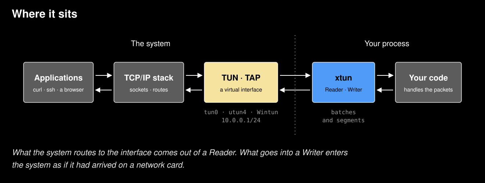
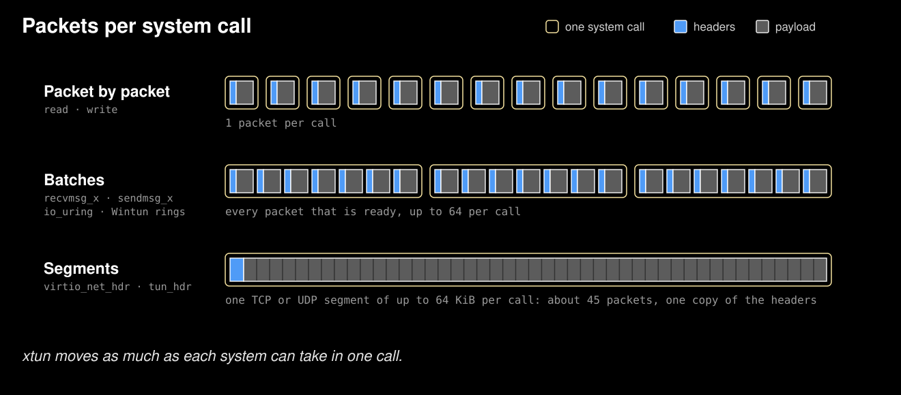
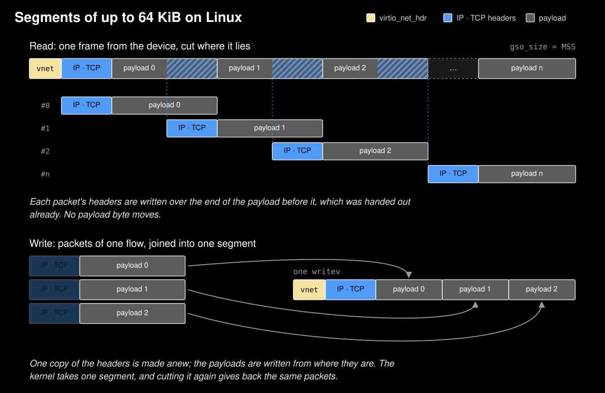
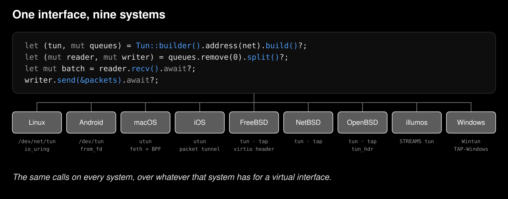
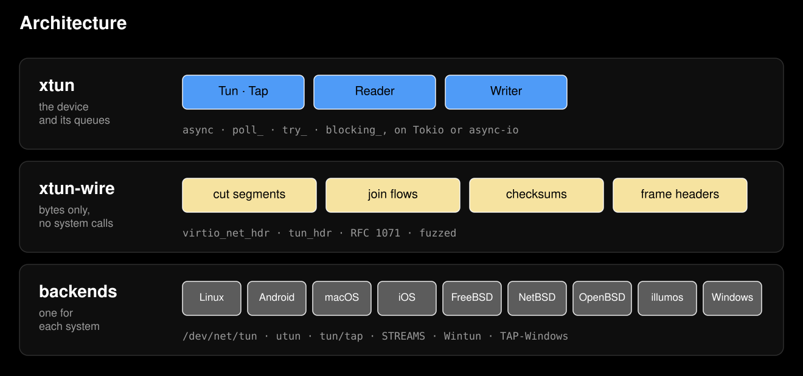
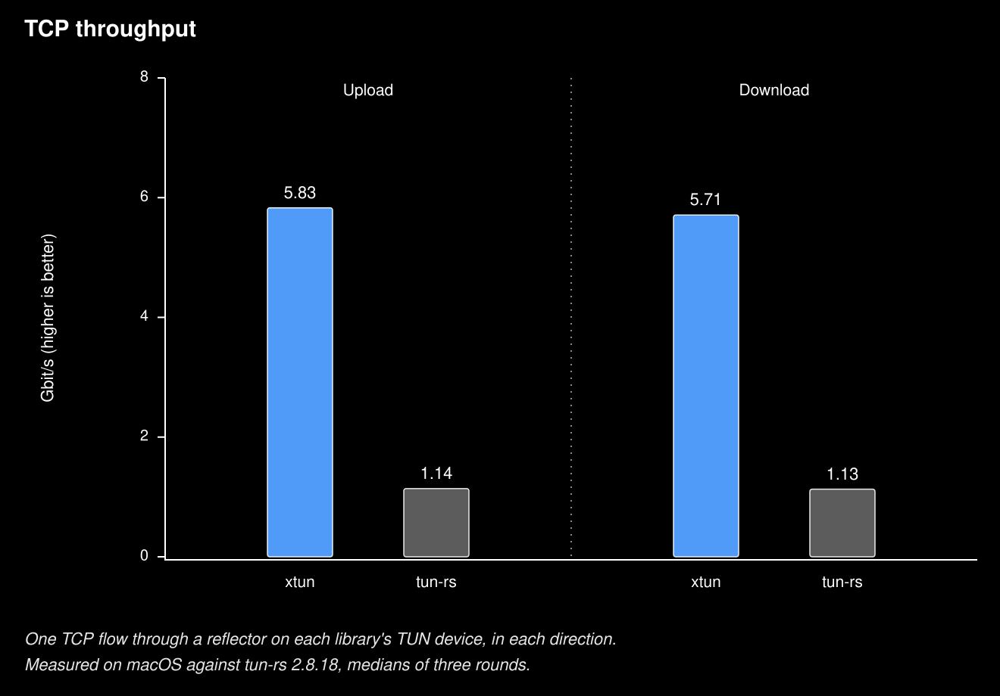

# xtun

TUN and TAP interfaces for Rust on Linux, Android, macOS, iOS, FreeBSD, NetBSD, OpenBSD, illumos and Windows, with batched and offloaded packet I/O.



## Batches and segments



Where the system offers it, a device hands over a whole TCP or UDP segment of up to 64 KiB in one read and takes one back in one write. `Frame::segments` cuts a segment into its packets inside the buffer it was read into, and the writer joins consecutive packets of a flow into one segment by the rules of Linux's own receive offload.



## Example

```rust
async fn example() -> std::io::Result<()> {
    let (tun, mut queues) = xtun::Tun::builder().address("10.0.0.1/24".parse().unwrap()).build()?;
    tun.set_mtu(1400)?;
    let (mut reader, mut writer) = queues.remove(0).split()?;
    loop {
        let mut batch = reader.recv().await?;
        let frames: Vec<_> = batch.frames().collect();
        let packets: Vec<_> = frames.iter().map(|frame| frame.packet()).collect();
        writer.send(&packets).await?;
    }
}
```

Every read and write comes as an `async` method, a `poll_` method, a `try_` method that never waits and a `blocking_` method that needs no runtime. `Device::from_fd` wraps a descriptor that something else opened, such as the one Android or an iOS packet tunnel hands to an application.

## Systems



| System | TUN | TAP | Segments |
| --- | --- | --- | --- |
| Linux | `/dev/net/tun`, multi-queue, io_uring from 6.4 | same device | TCP, and UDP from 6.2 |
| Android | `/dev/tun` or a descriptor the system hands over | same device | as Linux |
| macOS | `utun`, many packets per `recvmsg_x` / `sendmsg_x` | pair of `feth` interfaces with BPF | |
| iOS | `utun` of the packet tunnel provider | | |
| FreeBSD | `tun` device | `tap` device | TCP on TAP |
| NetBSD | `tun` device | `tap` device | |
| OpenBSD | `tun` device | `tap` device | TCP, behind `tun_hdr` |
| illumos | STREAMS `tun` driver | | |
| Windows | Wintun | TAP-Windows6 | |

The `tokio` feature, on by default, runs the asynchronous calls on Tokio; `async-io` runs them on the reactor of smol and async-std; `futures` adds `PacketStream` and `PacketSink`.

## Architecture



## Performance



`bench/` holds one reflector program that runs over xtun or over [tun-rs](https://crates.io/crates/tun-rs), so both are measured the same way. On macOS:

| | tun-rs | xtun |
| --- | --- | --- |
| TCP up, Gbit/s | 1.14 | 5.83 |
| TCP down, Gbit/s | 1.13 | 5.71 |
| UDP, million packets/s | 0.109 | 0.105 |
| ping idle, ms | 0.231 | 0.300 |
| ping under 1 Gbit/s of TCP, ms (p99) | 0.066 (0.134) | 0.064 (0.155) |
| ping under TCP at full speed, ms (p99) | 0.067 (0.142) | 5.307 (7.856) |

At full speed each library moves as much as it can, and xtun, five times faster, fills a queue of the system that tun-rs never reaches; under the same 1 Gbit/s the ping times of the two are the same.

## Tests

```bash
cargo test --workspace --all-features
```

The device tests create real interfaces. Each system has a script that builds them, takes them to a machine of that system and runs them there: `node scripts/linux.ts` in a container, `scripts/android.ts` on an emulator, `scripts/macos.ts`, `scripts/ios.ts` in the simulator, `scripts/vm/freebsd.ts`, `netbsd.ts`, `openbsd.ts` and `illumos.ts` in virtual machines, and `scripts/vm/windows.ts <user@address>` over SSH. The fuzz targets of `xtun-wire` are in `fuzz/`.
